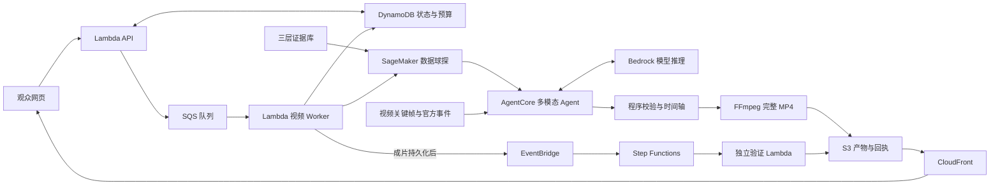

<div align="center">

# 🏀 GameBuddy

### Your AI Basketball Buddy · 陪你看懂每一个回合

**三层篮球数据 × Agentic RL 数据球探 × 多模态 Agent × 增强视频**

<p>
  
  
</p>

<p>
  <a href="#quick-start"></a>
  <a href="#stack"></a>
  <a href="#scout"></a>
  <a href="#aws"></a>
  <a href="LICENSE"></a>
</p>

<p>
  <a href="https://deky02484tknr.cloudfront.net/"><strong>比赛展示</strong></a> ·
  <a href="#demo"><strong>演示视频</strong></a> ·
  <a href="#architecture"><strong>技术架构</strong></a> ·
  <a href="#quick-start"><strong>快速开始</strong></a> ·
  <a href="docs/README.md"><strong>文档导航</strong></a>
</p>


</div>

## NBA × AWS 银奖

GameBuddy 是 Team02 在 **2026 NBA × AWS BroadcastCode 12h 黑客松**中开发的篮球观赛助手，获得本次比赛**银奖**。

我们把比赛视频、官方数据和 AI Agent 结合起来，对关键回合进行人物标注、战术定格和数据解读，再配上双人 AI 解说，生成可以直接观看的完整视频。除了进球，也关注前场篮板、无球站位和掩护重组这些容易被忽略的细节。

<p align="center">
  
</p>

## 项目概览

```text
比赛视频 + 官方事件
        ↓
基础数据 / 高阶派生 / 深度赛场 → 统一证据库
        ↓
3B 数据球探选择证据 → 多模态 Agent 读图、查证与组织解读
        ↓
程序校验数值与统计范围 → 时间轴同步 → 完整 MP4 烧录
        ↓
S3 / CloudFront → GameBuddy 观赛网页
```

| 观众会看到 | 背后的实现 |
|---|---|
| 一个回合的关键人物与关键一拍 | 关键帧、章节回看、人物强调与分段视觉叙事 |
| 镜头转换为容易阅读的战术板 | 源画面中的编辑锚点、攻防配色和图形转场 |
| 得分、效率和角色背景一起出现 | 基础统计、eFG/TS 与 Gravity/Leverage/Shot Difficulty 的证据关联 |
| 出手回放时出现官方 xFG | 视频事件与官方 `actionNumber` 对齐，取数及来源校验 |
| 双人 AI 解说与陪伴式界面 | 审核后的脚本、TTS、音画对齐和 GameBuddy 篮球伙伴 |
| 可以保存和分享的视频 | 标注与解读永久烧录到 MP4 |

<a id="demo"></a>

## 演示视频

最终答辩中的两段视频：

<table>
  <tr>
    <td width="50%" align="center">
      <a href="https://github.com/imhaojie/GameBuddy/releases/download/presentation-demos/gamebuddy-possession-demo.mp4"></a>
      <br/><strong>回合解读</strong> · 55 秒
      <br/><a href="https://github.com/imhaojie/GameBuddy/releases/download/presentation-demos/gamebuddy-possession-demo.mp4">观看 / 下载</a>
    </td>
    <td width="50%" align="center">
      <a href="https://github.com/imhaojie/GameBuddy/releases/download/presentation-demos/gamebuddy-introduction.mp4"></a>
      <br/><strong>GameBuddy 介绍</strong> · 55 秒
      <br/><a href="https://github.com/imhaojie/GameBuddy/releases/download/presentation-demos/gamebuddy-introduction.mp4">观看 / 下载</a>
    </td>
  </tr>
</table>

回合解读展示 **Max Christie 的二次进攻**：首攻被封盖，Dwight Powell 抢回前场篮板，球队重新组织，Christie 完成后撤步打板三分。约 23.78 秒的源回合，通过定格、回看和慢放展开为约 55 秒的增强视频。

<table>
  <tr>
    <td width="50%"><br/><strong>切入与协防</strong></td>
    <td width="50%"><br/><strong>篮板与二次进攻</strong></td>
  </tr>
  <tr>
    <td width="50%"><br/><strong>战术重组</strong></td>
    <td width="50%"><br/><strong>xFG 与出手回放</strong></td>
  </tr>
</table>

观赛页面提供沉浸式、全场和半场三种布局，支持章节回看、数据查看和观赛偏好设置。

<p align="center">
  
</p>

<a id="highlights"></a>

## 技术特点

| 特点 | 实现 |
|---|---|
| **三层数据融合** | 将比赛事实、派生效率、机会质量及角色背景组织为同一套证据记录，同时保留不同的单位和统计范围。 |
| **Agentic RL 数据球探** | 基于 Qwen2.5-3B、QLoRA SFT 和分组策略梯度训练工具使用与证据选择，模型返回短证据 ID。 |
| **多模态 Agent** | 读取视频帧和工具返回的数据，生成解读并按校验结果修订。 |
| **确定性事实校验** | 数字从来源记录复制；程序检查主体、指标、单位、时期和来源，按公式计算高阶指标。 |
| **回合视觉叙事** | 人物强调、战术暂停、镜头到俯视板转场、慢放、命中反馈和分时数据揭示共同组织观看节奏。 |
| **双时间轴** | 原片时间定位证据，成片时间安排定格和回放，明确记录两者映射。 |
| **陪伴式观赛** | 篮球伙伴配合三态布局、章节回看和观赛偏好设置。 |
| **完整增强视频** | 用 FFmpeg 永久烧录标注与数据；AI 解说按既定时间线合成。 |
| **AWS 异步交付** | 通过队列生成视频，独立检查成片，再由 CDN 交付给观众。 |

<a id="architecture"></a>

## 系统架构

<p align="center">
  
</p>

系统分为五个模块：

1. **Video & Three-layer Evidence**：将视频关键帧、官方事件和三层数据关联，形成带来源的证据库。
2. **Agentic RL Data Scout**：离线训练数据球探，再通过 SageMaker 端点服务选择证据与受控关系。
3. **Evidence-grounded Agent**：AgentCore 托管工具型 Agent，Bedrock 模型读取画面、查询证据并修订叙事。
4. **Enhanced Video Production**：验证脚本与编辑锚点对齐时间轴，由 FFmpeg 输出完整增强 MP4。
5. **Cloud Delivery & Companion UX**：S3 保存产物，CloudFront 提供网页和视频，播放器支持继续探索。

底部的 Lambda、SQS、DynamoDB、EventBridge、Step Functions 和 CloudWatch 支撑任务调度、状态管理、验收与观测。

<details>
<summary>展开可编辑的数据流</summary>



</details>

自动 RL 样片跑通了选证、Agent 叙事和视频烧录。55 秒答辩片结合编辑视觉、AgentCore 稿件审核与双人解说。

<a id="data"></a>

## 三层数据融合

冻结证据库包含 **1,993 条记录**，关联 **33 位球员、4 场比赛**以及赛季背景。

| 数据层 | 记录数 | 内容 | 统计口径 |
|---|---:|---|---|
| 基础数据 | 1,513 | 得分、投篮计数、篮板、助攻、抢断等 | 对应比赛的官方统计 |
| 高阶派生 | 166 | eFG、TS | 基于官方操作数与明确公式计算 |
| 深度赛场 | 314 | Gravity 90、Leverage 160、Shot Difficulty 64 | NBA 赛季来源快照 |

**本次出手的官方 xFG 单独保存**，与赛季平均机会质量区分。统一证据字段包括：

```text
playerId · teamId · gameId · metric · value · unit
grain · period · source · evidenceId
```

数据球探选择 `evidenceId` 和允许的关系，程序从来源取数。eFG、TS 保存公式及操作数；缺失数据保留缺失状态，跨表比较要求指标、单位、时期及来源口径一致。

已验收的弗拉格自动样片同时使用 **本场 34 分、eFG 54.00%、赛季无球外线引力 6.217**；该次出手的官方 **xFG 51.0%** 独立展示。正式 Christie 片中，**event 273 的 xFG 30%**、全场派生效率和赛季深度分数也分别标注范围。

赛季快照用于补充球员背景，与回合数据分开标注。Gravity 和 Leverage 保留来源分数，不换算为命中率。

<a id="scout"></a>

## Agentic RL 数据球探

数据球探学习的是 **怎样调用篮球工具、选择相关证据并遵守语义边界**。视觉模型负责看画面，文本球探负责取证，确定性程序负责数字和最终显示。

```text
真实证据任务 → QLoRA 监督微调 → 分组强化学习
             → SageMaker 端点 → 工具调用 / 证据 ID / 关系
             → 语义校验与有限纠错 → Agent 叙事 → 视频烧录
```

| 项目 | 配置与结果 |
|---|---|
| 基础模型 | Qwen2.5-3B-Instruct |
| 训练平台 | 正式 AWS SageMaker，单台 `ml.g5.xlarge` / NVIDIA A10G |
| 监督训练 | 4-bit NF4 QLoRA，rank 16；640 次样本训练，291 条不同训练题 |
| RL 实验 | 30 轮采样、240 条轨迹、7 次实际权重更新 |
| 奖励与约束 | 结构化协议、工具返回证据、指标语义、可用性、关系及统计范围 |
| 产品运行 | 训练后模型 + 语义校验 + 最多一次模型纠错 |
| 已知案例验收 | 两段注册样片 × 三种深度关注方向，最终 6/6 通过，其中 1 次经过纠错 |
| 端到端实例 | 弗拉格任务实际选证 2.841 秒、2 次生成，三层证据进入叙事与完整 MP4 |

6/6 是已知样片上模型与语义校验的联合结果，2.841 秒为单次任务的取证耗时。

<details>
<summary>训练结果与实验限制</summary>

| 阶段 | 冻结验证集 | 冻结测试集 |
|---|---:|---:|
| 训练前 | 0/16 | 0/16 |
| SFT 后 | 15/16 | 16/16 |
| RL 后 | 15/16 | 16/16 |

SFT 改善了工具协议与证据选择，本轮 **RL 相对 SFT 未观察到额外增益**。实验使用一个随机种子，每组 16 道题，四场比赛均用于开发。

训练实现采用分组归一化优势，基于当前策略采样后进行单次策略梯度更新，没有实现带参考 KL 的完整 GRPO 或 clipped PPO。

[训练结果](docs/RL三层联合训练结果-20261010.md) · [服务交付](docs/RL服务交付-20261010.md) · [端到端接入](docs/RL产品端到端联调验收-20261010.md)

</details>

<a id="aws"></a>

## AWS 服务

项目使用 **13 项 AWS 能力**完成模型训练、Agent 运行和视频交付。Polly 与 Rekognition 为可选辅助服务。

| 服务 | 项目职责 |
|---|---|
| **Amazon Bedrock AgentCore** | 托管工具型 Agent，执行读图、查证、修订和稿件审核 |
| **Amazon Bedrock** | Claude Sonnet 4.6 多模态理解与叙事推理 |
| **Amazon SageMaker AI** | 数据球探训练、模型打包与实时端点推理 |
| **AWS Lambda** | Function URL API、视频 Worker、独立验证和可选语音处理 |
| **Amazon SQS** | 长任务排队、重试与死信队列 |
| **Amazon DynamoDB** | 任务状态、运行预算、输入输出身份及验收回执 |
| **Amazon S3** | 视频、帧、数据快照、完整成片和原始记录 |
| **Amazon CloudFront** | HTTPS 网页与媒体交付、私有源访问与视频 Range 请求 |
| **Amazon EventBridge** | 成片保存后发布 `VideoRendered` 事件 |
| **AWS Step Functions** | STANDARD 工作流编排独立交付验收 |
| **Amazon CloudWatch** | 日志、运行指标、看板与 6 项失败或积压告警 |
| **Amazon Polly** | 可选 AWS 原生章节 TTS 派生 |
| **Amazon Rekognition** | 可选比赛场景标签辅助 |

工程支撑包括 **AWS CDK、CloudFormation、IAM 和 STS**。主链基础设施用代码定义，工作负载按角色分工并遵守赛事权限边界，部署前核验账号身份。

服务之间的配合：

- **异步生成**：API → SQS → Worker，DynamoDB 提供进度；网页无需同步等待完整生成。
- **独立验收**：成片持久化后 → EventBridge → Step Functions → 验证 Lambda，检查来源、哈希、时长、音轨和解码结果。
- **可控交付**：私有 S3 通过 CloudFront OAC 交付，使用缓存复用不可变媒体；失败日志、队列积压和死信可独立定位。

Worker 使用单并发与批次 1 控制生成资源和推理预算。可选语音派生失败保留主成片；“生成完成”和“通过交付检查”分别记录。

<a id="quick-start"></a>

## 快速开始

### 1. 获取源码并打开观赛前端

需要 **Python 3.11+**；推荐近期桌面 Chrome 或 Edge。前端采用原生 ESM，默认本地预览不需要安装 npm 依赖，也不需要 AWS 账号。

```bash
git clone https://github.com/imhaojie/GameBuddy.git
cd GameBuddy
python3 product/watch/preview.py --port 4178
```

打开 **http://127.0.0.1:4178/**。没有比赛媒体时，也可以查看界面与设置。

使用有权使用的注册样片时，将 `flagg.mp4` 和 `amen.mp4` 放在仓库外的媒体目录：

```bash
python3 product/watch/preview.py --port 4178 --media-dir /path/to/local-media
```

这些文件名对应仓库中的既定样片及事件映射；替换为其他视频时，需要同时完成事件和标注适配。更多说明见[前端文档](product/watch/README.md)。

### 2. 查看本地产品、历史运行与证据

```bash
python3 product/scripts/serve.py
```

打开 **http://127.0.0.1:4173/product/**。该入口读取本地媒体与历史任务。答辩视频可从上方演示区下载，开发所需的原始比赛视频与模型权重需另行准备。

### 3. 运行离线工程检查

需要 **Node.js 22** 和 Python 3.11+：

```bash
npm ci --prefix product --ignore-scripts
python3 product/scripts/check.py --full
```

离线检查覆盖源码、凭据、语法、行为测试和 CDK 模板，使用合成媒体占位，不调用云服务。

### 4. 查看训练计划或复现渲染

训练计划可以在不加载模型、不连接 AWS 的情况下检查：

```bash
python3 product/rl/train_evidence.py --dry-run --out product/build/rl-plan
```

真实训练需要对应 GPU 环境及模型依赖；渲染需要 FFmpeg、固定媒体工具、字体和授权源视频。完整路径见[工程指南](product/README.md)、[三层数据训练记录](docs/RL三层联合训练结果-20261010.md)和[正式视频渲染](product/broadcast-fx/formal/README.md)。

### 5. AWS 复现

在自己的 AWS 账号复现时，需要调整账号、执行角色、权限边界、模型访问和 SageMaker 端点配置。

赛事环境已 bootstrap，禁止重复执行。赛后参赛账号的模型和管理权限已受限，本地复现与云部署步骤见[产品工程指南](product/README.md)。

<a id="stack"></a>

## 技术栈与仓库结构

| 层 | 技术 |
|---|---|
| 观赛前端 | HTML / CSS、原生 JavaScript ESM、Canvas、可选 liquidGL 3.0.0 |
| 视频处理 | Python、FFmpeg / ffprobe、OpenCV、Pillow、NumPy |
| 模型训练 | Qwen2.5-3B、QLoRA、SFT、分组策略梯度、SageMaker |
| Agent 推理 | Bedrock AgentCore、Claude Sonnet 4.6、结构化工具契约 |
| 语音 | 提交版豆包 TTS、本地英文答辩版 MOSS-TTS、可选 Polly |
| 云基础设施 | AWS CDK JavaScript、CloudFormation、IAM、STS |
| 质量检查 | Python unittest、Node test runner、离线 CDK 合成 |

```text
GameBuddy/
├── product/                  # 当前产品与部署工程
│   ├── watch/                # 玻璃播放器、三态布局与观赛交互
│   ├── web/                  # 像素风展示与历史创作界面
│   ├── agent/                # AgentCore 入口、工具循环与叙事契约
│   ├── rl/                   # 三层证据、球探训练、端点客户端与结果
│   ├── worker/               # 异步视频生成与 RL 接入
│   ├── delivery/             # 独立验收与可选语音派生
│   ├── broadcast-fx/         # 回合视觉、战术场景与时间轴渲染
│   ├── court-lab/            # 编辑俯视示意研究原型
│   ├── api/                  # 任务接口及预算控制
│   ├── data/                 # 注册案例、官方事件与解说稿
│   ├── evidence/             # 实际运行、成功与失败验收记录
│   ├── scripts/              # 本地预览、构建、发布与检查
│   └── app.js                # 主链 AWS CDK 定义
├── docs/                     # 架构、指南、演示与比赛归档
├── readiness-lab/            # 历史练习流水线与固定媒体构建工具
├── aws-validation/           # 历史服务验证代码
├── scripts/                  # 源码与 Git 存档工具
├── SHOWCASE.md               # 保留的比赛作品说明，独立于本 README
├── THIRD_PARTY_NOTICES.md     # 第三方代码、数据、字体及媒体说明
└── LICENSE                   # 原创代码 MIT 许可证
```

`readiness-lab/` 和 `aws-validation/` 保留历史工程，其中 `readiness-lab/` 仍提供媒体构建工具。展示视频托管在 GitHub Releases，原始媒体与权重不放入源码仓库。

## 文档

| 阅读目的 | 文档 |
|---|---|
| 本地启动、依赖与工程入口 | [产品工程指南](product/README.md) |
| 三态布局、媒体目录、观赛设置 | [观赛前端](product/watch/README.md) |
| 数据球探的真实成片接入 | [RL 产品端到端联调](docs/RL产品端到端联调验收-20261010.md) |
| 模型效果、失败与实验边界 | [联合训练结果](docs/RL三层联合训练结果-20261010.md) |
| 比赛提交视频与 AI 双人解说 | [正式 55 秒作品](docs/正式55秒豆包双人解说与主页发布-20261010.md) |
| 最终英文答辩片 | [PPT 最终演示视频](docs/PPT最终演示视频-20261011.md) |
| 服务协同、交付验证与监控 | [AWS 托管交付闭环](docs/AWS托管交付闭环-20261010.md) |
| 历史成果及整理后的完整导航 | [文档首页](docs/README.md) |

当前支持已登记的样片与比赛素材，新视频需要适配事件映射和标注。战术板位置、箭头和人物轮廓采用编辑示意。

观赛偏好用于界面与现有内容展示，尚未全部接入创作 Agent。AI 解说、官方数据与编辑解释分别记录来源。

## 贡献与致谢

欢迎通过 Issue 描述可复现的问题，或通过 Pull Request 改进数据工具、前端体验、视频渲染与工程文档。提交前运行上述离线检查，并为数据或媒体附上来源、单位与统计范围。

感谢 NBA × AWS 主办方、现场评委与技术支持，以及所有参与开发和答辩的 Team02 队友。项目使用 Qwen、FFmpeg、liquidGL、Fusion Pixel 等模型、工具或素材；第三方许可与来源见 [THIRD_PARTY_NOTICES.md](THIRD_PARTY_NOTICES.md)。

## 许可证

原创代码采用 [MIT License](LICENSE)。数据、视频、照片、模型及其他第三方素材的许可见 [THIRD_PARTY_NOTICES.md](THIRD_PARTY_NOTICES.md)。
